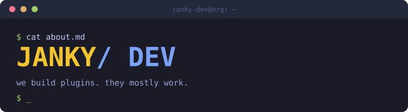
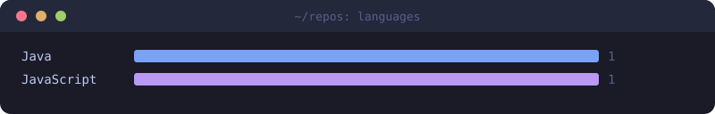

**we build plugins. they mostly work.** ✨

<table><tr>
<td width="140" valign="middle"></td>
<td valign="middle">

Janky Dev isn't a studio: no investors, no Jira board silently judging us. A small crew of coders (me, me, me and mostly me) building Minecraft plugins for a server we actually play on. If it's useful to you too, take it.

</td>
</tr></table>

## 🔌 Plugins

<table><tr>
<td width="33%" valign="top">

<h3>FakePlayerPlugin 2.0</h3>

The rewrite nobody asked for but everybody needed. Same idea as Origin, planned this time instead of improvised. Better pathing, better performance, doesn't fall over if two fake players exist at once.

<code>npc</code> <code>testing</code> <code>paper</code> <code>purpur</code> <code>folia</code>

 

</td>
<td width="33%" valign="top">

<h3>FakePlayerPlugin Origin</h3>

The original fake-player spawner. Built in a weekend, held together by hope and a few try/catch blocks we're not proud of. Still running because nobody wants to be the one who breaks it.

<code>npc</code> <code>testing</code> <code>pvp</code> <code>pathfinding</code>

</td>
<td width="33%" valign="top">

<h3>Scripted SMP Core</h3>

The plugin nobody sees but everything depends on. The backbone of our SMP server: teams, nicknames, proximity chat, death tracking, recording mode and admin tools in one place.

<code>core</code> <code>smp</code> <code>utility</code>

 

</td>
</tr></table>

## 🧭 How we operate

- **Build it for our own server first.** Everything here started as something we needed.
- **Ship once it stops crashing,** not once it's "done".
- **Write real documentation,** and get a logo that isn't Comic Sans (in progress).

## 🛠 Latest activity

| Repo | Language | Stars | Last push |
| ---- | -------- | ----- | --------- |
| [.github](https://github.com/Janky-Development/.github) | JavaScript | ⭐ 0 | today |
| [Fake-Player-plugin-2.0](https://github.com/Janky-Development/Fake-Player-plugin-2.0) | Java | ⭐ 10 | today |
| [Scripted-SMP-Core-Public](https://github.com/Janky-Development/Scripted-SMP-Core-Public) | - | ⭐ 0 | today |

## 📊 Languages

<!-- Last updated on Sat Oct 31 2026 20:54:36 GMT+0000 (Coordinated Universal Time) ;-;-->
last updated 31st October 2026 using magic · <a href="https://github.com/Janky-Development">@Janky-Development</a>

